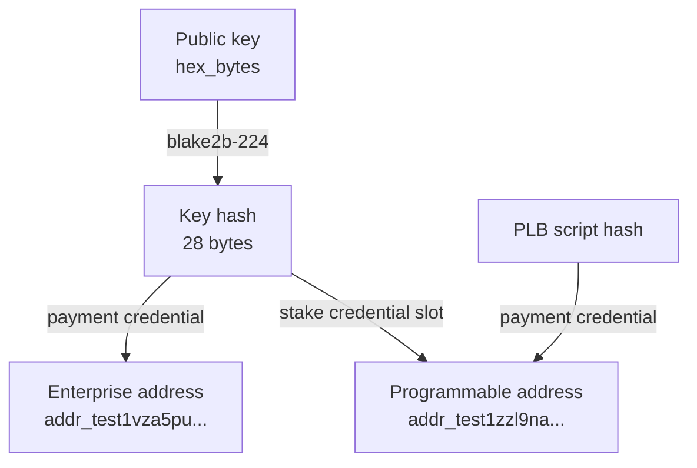
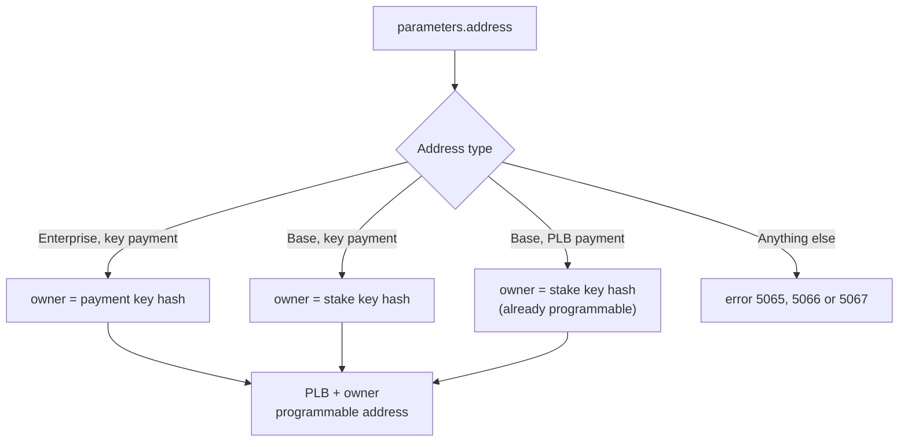
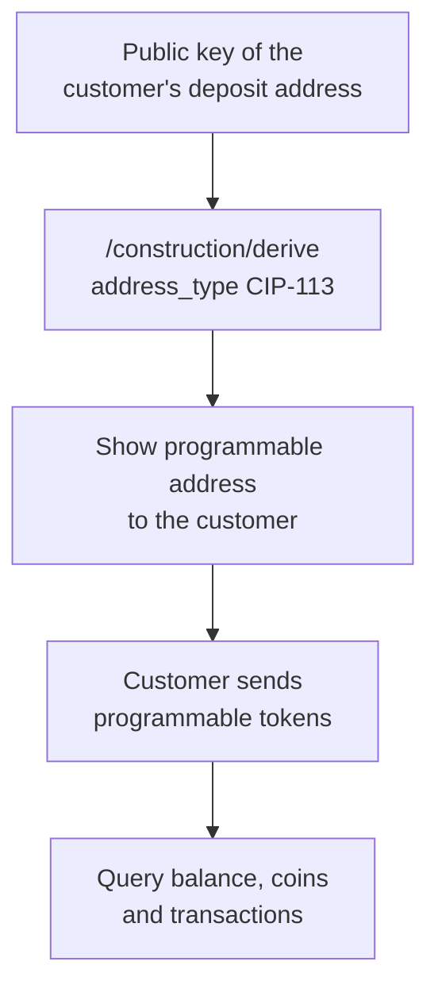

import Tabs from '@theme/Tabs';
import TabItem from '@theme/TabItem';

# Deriving and Resolving Addresses

## Overview

Programmable tokens are not held at a customer's regular address (see [Programmable Tokens and Addresses](./index.md)). To receive, track or credit them, you first need the customer's **programmable address**. Cardano Rosetta Java provides two ways to get it:

| You have                                          | Use                                                                      | Endpoint                 |
| ------------------------------------------------- | ------------------------------------------------------------------------ | ------------------------ |
| A public key (the one behind a deposit address)   | [`address_type: "CIP-113"`](#deriving-an-address-constructionderive)     | `/construction/derive`   |
| An address (customer-provided or already stored)  | [`resolve_smart_wallet_addr`](#resolving-an-address-call)                | `/call`                  |

Both return the same kind of address and both require [`CIP113_BASE_SCRIPT_HASH`](./index.md#configuration) to be configured on the server.

## The owner credential Rosetta uses

Rosetta builds a programmable address from a single 28-byte key hash, the **owner credential**:

```
programmable address = PLB script hash    (payment credential)
                     + owner key hash     (stake credential slot)
```

The same key hash also produces the customer's regular enterprise address, which is why one public key is enough to get both addresses:



The owner credential depends on what you start from:

| Input                                       | Owner credential                          |
| ------------------------------------------- | ----------------------------------------- |
| Public key (`/construction/derive`)         | blake2b-224 hash of the public key        |
| Enterprise address (`/call`)                | Its payment key hash                      |
| Base address (`/call`)                      | Its **stake** key hash                    |
| Programmable address (`/call`)              | Its owner credential, unchanged           |

This matches the convention described in the CIP-113 integration guide: the payment key hash is used for enterprise wallets without a stake key (the exchange pattern), and the stake key hash for wallets with a base address.

:::warning One person, two possible programmable addresses
On chain, the validators accept either a payment key hash or a stake key hash in the stake credential slot. A wallet that has a base address with *different* payment and stake keys can therefore own two programmable addresses, depending on which credential the sender used. Rosetta derives the payment-key-based address from a public key or enterprise address, and the stake-key-based address from a base address.

For **deposits**, give the customer the address returned by `/construction/derive` and always credit that exact address. If you need the stake-key-based address of a base-address wallet, use `/call` with that base address, or pass the stake public key as `public_key` to `/construction/derive`. For **withdrawals** to a customer-supplied address, confirm which address the customer's wallet monitors if it is a base address.
:::

## Deriving an address (`/construction/derive`)

Set `metadata.address_type` to `"CIP-113"` and send the public key you already use for the customer's deposit address. The response contains the programmable address.

<Tabs>
  <TabItem value="request" label="Request" default>

```json
{
  "network_identifier": {
    "blockchain": "cardano",
    "network": "preprod"
  },
  "public_key": {
    "hex_bytes": "1B400D60AAF34EAF6DCBAB9BBA46001A23497886CF11066F7846933D30E5AD3F",
    "curve_type": "edwards25519"
  },
  "metadata": {
    "address_type": "CIP-113"
  }
}
```

  </TabItem>
  <TabItem value="response" label="Response">

```json
{
  "account_identifier": {
    "address": "addr_test1zzl9nam4pfweg7akf8ns646dqenermp55807u2sg0jz3rcamgrc6v3au3rqm66mn3kuwke340kfxga82tl7kh2nke8as2mmcxg"
  }
}
```

  </TabItem>
  <TabItem value="enterprise" label="Same key, Enterprise">

Without `metadata`, or with `address_type: "Enterprise"`, the same public key returns the regular deposit address:

```json
{
  "account_identifier": {
    "address": "addr_test1vza5pudxg77g3sdaddecmw8tvc6hmynywn49lltt4fmvn7c6mzywr"
  }
}
```

  </TabItem>
</Tabs>

The two addresses share the key hash `bb40f1a647bc88c1bd6b738db8eb66357d926474ea5ffd6baa76c9fb`. In the programmable address it sits in the stake credential slot, behind the PLB script hash `be59f7750a5d947bb649e70d574d066791ec34a1dfee2a087c8511e3` (preprod).

Rules for this address type:

- `address_type` is case-sensitive. Valid values are `Enterprise`, `Base`, `Reward` and `CIP-113`.
- The address is derived from `public_key` only. Do not send `metadata.staking_credential`; it is rejected (error `5062`) rather than ignored.
- `hex_bytes` is the raw public key: 64 hexadecimal characters (32 bytes), or 128 characters for an extended key with chain code. Do not add a `0x` prefix or a type byte.
- `curve_type` may be omitted, but if present it must be `edwards25519`.
- The result is a base address: script payment credential (PLB) and key stake credential slot.

## Resolving an address (`/call`)

The `resolve_smart_wallet_addr` method takes any supported address and returns the programmable address that belongs to the same owner. It does not need a public key, so it works for addresses you only know as strings, such as a customer's withdrawal destination.

<Tabs>
  <TabItem value="enterprise" label="Enterprise input" default>

```json
{
  "network_identifier": {
    "blockchain": "cardano",
    "network": "preprod"
  },
  "method": "resolve_smart_wallet_addr",
  "parameters": {
    "address": "addr_test1vpwcgn22xnj8gnen0snfcjgyqp0jfgc6kufgmjlk2fm7mvg5ys3p3"
  }
}
```

```json
{
  "result": {
    "account_identifier": {
      "address": "addr_test1zzl9nam4pfweg7akf8ns646dqenermp55807u2sg0jz3rc6as3x55d8yw38nxlpxn3ysgqzlyj334dcj3h9lv5nhakcsudhvdm"
    }
  },
  "idempotent": true
}
```

This is a real preprod pair. The enterprise address holds the key hash `5d844d4a34e4744f337c269c4904005f24a31ab7128dcbf65277edb1` as its payment credential, and the programmable address holds the same hash in its stake credential slot.

  </TabItem>
  <TabItem value="base" label="Base input">

```json
{
  "network_identifier": {
    "blockchain": "cardano",
    "network": "preprod"
  },
  "method": "resolve_smart_wallet_addr",
  "parameters": {
    "address": "addr_test1qza5pudxg77g3sdaddecmw8tvc6hmynywn49lltt4fmvn7cqzppp5sllda3lrk5k7txy6kg5w2afqpfh2spwxxjc7t2s52m4r0"
  }
}
```

```json
{
  "result": {
    "account_identifier": {
      "address": "addr_test1zzl9nam4pfweg7akf8ns646dqenermp55807u2sg0jz3rccqzppp5sllda3lrk5k7txy6kg5w2afqpfh2spwxxjc7t2spnypen"
    }
  },
  "idempotent": true
}
```

The owner credential is the **stake** key hash of the base address. The payment part is ignored.

  </TabItem>
  <TabItem value="programmable" label="Programmable input">

```json
{
  "network_identifier": {
    "blockchain": "cardano",
    "network": "preprod"
  },
  "method": "resolve_smart_wallet_addr",
  "parameters": {
    "address": "addr_test1zzl9nam4pfweg7akf8ns646dqenermp55807u2sg0jz3rc6as3x55d8yw38nxlpxn3ysgqzlyj334dcj3h9lv5nhakcsudhvdm"
  }
}
```

```json
{
  "result": {
    "account_identifier": {
      "address": "addr_test1zzl9nam4pfweg7akf8ns646dqenermp55807u2sg0jz3rc6as3x55d8yw38nxlpxn3ysgqzlyj334dcj3h9lv5nhakcsudhvdm"
    }
  },
  "idempotent": true
}
```

A programmable address that is owned by a key (PLB payment credential, key stake credential) is returned unchanged. You can therefore call the method on every key-based destination without checking its type first. A programmable address owned by a **script** (a dApp or DAO) cannot be resolved and returns error `5066`.

  </TabItem>
</Tabs>

The method is idempotent: the result depends only on the input address, the network and the configured PLB script hash. The input must belong to the network in `network_identifier`.

### What each input resolves to



| Input address                                             | Result                    |
| --------------------------------------------------------- | ------------------------- |
| Enterprise address, key payment credential                | Programmable address      |
| Base address, key payment and key stake credentials       | Programmable address      |
| Base address with the configured PLB as payment, key stake | Returned unchanged       |
| Base address with a script stake credential (including a script-owned programmable address) | Error `5066` |
| Enterprise address, script payment credential             | Error `5065`              |
| Base address, key stake credential, script payment credential other than PLB | Error `5065` |
| Reward (`stake_...`), pointer or Byron address            | Error `5066`              |
| Not a Cardano address, or on another network              | Error `5067`              |
| Missing, blank or non-string `address` parameter          | Error `5051`              |

## Exchange recipes

### Credit deposits: derive from the key you already have



1. Take the `hex_bytes` of the public key you already use to derive the customer's enterprise deposit address.
2. Call `/construction/derive` with `address_type: "CIP-113"` and store the returned programmable address next to the enterprise address.
3. Give the programmable address to the customer for programmable token deposits. The enterprise address remains valid for ADA and regular native tokens.
4. Monitor both addresses with the [Data API](./querying.md). They are independent addresses; there is no sub-account link between them.

Your existing key management does not change. The same private key authorizes spending from both addresses.

### Mirror existing addresses

If you already store a customer's enterprise or base address and not the public key, call `resolve_smart_wallet_addr` once and store the result. For an enterprise address the result is identical to what `/construction/derive` returns for the matching public key.

### Validate a withdrawal destination

A customer may provide an enterprise, base or programmable address as the destination of a withdrawal. Resolve it first:

1. Call `resolve_smart_wallet_addr` with the address the customer provided.
2. Use the returned programmable address as the destination of the transfer, in the tooling that builds the programmable-token transaction.
3. Treat error `5065` or `5067` as an invalid destination for programmable tokens. Error `5066` also covers script-owned programmable addresses and other types that Rosetta does not resolve, so review those destinations manually instead of rejecting them outright.

:::note
Building the programmable-token transfer itself is outside the scope of Rosetta today (see [What Rosetta supports](./index.md#what-rosetta-supports)). Rosetta gives you the correct address and then reports the confirmed transaction.
:::

## Errors

| Code   | Message                                                                  | Endpoint                  | Cause and fix                                                                                  |
| ------ | ------------------------------------------------------------------------ | ------------------------- | ---------------------------------------------------------------------------------------------- |
| `5062` | `metadata.staking_credential is not allowed for CIP-113 address derivation` | `/construction/derive` | `staking_credential` was sent with `CIP-113`. Remove it.                                       |
| `5063` | `Configure CIP113_BASE_SCRIPT_HASH to derive CIP-113 addresses`          | derive, `/call`           | The server has no PLB script hash. Set [`CIP113_BASE_SCRIPT_HASH`](./index.md#configuration).  |
| `5064` | `CIP113_BASE_SCRIPT_HASH must be a 28-byte hex string`                   | derive, `/call`           | The configured value is not 56 hexadecimal characters. Fix the configuration.                  |
| `5065` | `Address is not a CIP-113 smart wallet`                                  | `/call`                   | A script payment credential that cannot be mapped to a key owner: an enterprise script address, or a base address with a key stake credential whose payment script is not the configured PLB. (A base address with a script stake credential returns `5066` first.) Provide a key-based address. |
| `5066` | `Address type not supported for resolve_smart_wallet_addr`               | `/call`                   | Reward, pointer, Byron, or a base address with a script stake credential (also a script-owned programmable address). Provide an enterprise or base address with key credentials. |
| `5067` | `Invalid address for resolve_smart_wallet_addr`                          | `/call`                   | Malformed address, or the address belongs to another network than `network_identifier`.        |
| `5051` | `Call parameter missing`                                                 | `/call`                   | `parameters.address` is missing, blank or not a string.                                           |
| `4007` | `Invalid public key format`                                              | derive                    | `hex_bytes` is not hexadecimal, or not 64 characters (32-byte key) or 128 characters (extended key with chain code), or `curve_type` is not `edwards25519`. |
| `4016` | `Provided address type is invalid`                                       | derive                    | `address_type` is not one of `Enterprise`, `Base`, `Reward`, `CIP-113` (case-sensitive).       |

Example error responses:

<Tabs>
  <TabItem value="5065" label="5065 script address" default>

```json
{
  "code": 5065,
  "message": "Address is not a CIP-113 smart wallet",
  "retriable": false,
  "details": {
    "message": "Enterprise script payment credentials are not supported"
  }
}
```

  </TabItem>
  <TabItem value="5066" label="5066 reward address">

```json
{
  "code": 5066,
  "message": "Address type not supported for resolve_smart_wallet_addr",
  "retriable": false,
  "details": {
    "message": "Reward addresses are not supported"
  }
}
```

  </TabItem>
  <TabItem value="5067" label="5067 wrong network">

```json
{
  "code": 5067,
  "message": "Invalid address for resolve_smart_wallet_addr",
  "retriable": false,
  "details": {
    "message": "Address network does not match requested network 'preprod'"
  }
}
```

  </TabItem>
</Tabs>

All errors are also listed by `/network/options`.

## Next steps

- [Querying Balances, Coins and Transactions](./querying.md): read the tokens held at the programmable address.
- [API Reference](/cardano-rosetta-java/api): request and response schemas for `/construction/derive` and `/call`.
