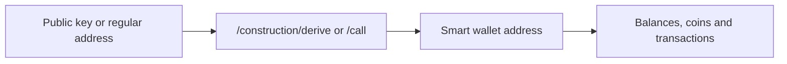

# CIP-113 Programmable Tokens

## Overview

CIP-113 programmable tokens are native Cardano assets governed by on-chain validation logic. This allows issuers to enforce rules such as transfer restrictions, freezing or seizure while keeping the token compatible with Cardano’s native-asset model. A programmable token is identified by its policy ID and asset name, just like any other native asset.

Programmable tokens are held in UTxOs locked by the programmable logic base (PLB) validator. A customer’s smart wallet consists of these UTxOs, with ownership identified by the smart wallet address’s stake credential.

Rosetta constructs the smart wallet address as a base address with two credentials:

- **Payment credential**: the PLB script hash configured in [`CIP113_BASE_SCRIPT_HASH`](../../install-and-deploy/env-vars.md). It identifies the validator that controls spending.
- **Stake credential**: the owner’s key hash, selected from the input as explained in [Deriving and Resolving Addresses](./addresses.md#the-owner-credential-rosetta-uses).

Spending these UTxOs runs the PLB validator, which requires the CIP-113 validation flow. The dispatcher and delegated validators use zero-ADA withdrawals to enforce the applicable rules.

## Phase 1 support

Cardano Rosetta Java’s Phase 1 CIP-113 implementation focuses on smart wallet address handling and querying existing on-chain activity. This phase lets you:

1. Derive a smart wallet address from a public key with [`/construction/derive`](./addresses.md#deriving-an-address-constructionderive).
2. Resolve a supported customer address with [`/call`](./addresses.md#resolving-an-address-call).
3. Read balances, UTxOs and transaction history with the standard [Data API](./querying.md).

Transaction building is not included in this phase and may be added in a future phase.

:::tip The short version
Query the smart wallet address for its token and ADA balances. Query the customer’s regular address separately when you also need its balances. Rosetta does not combine balances across addresses.
:::

## References

- [CIP-113 specification](https://cips.cardano.org/cip/CIP-0113)
- [CIP-113 on-chain contracts](https://github.com/cardano-foundation/cip113-programmable-tokens)
- [CIP-113 platform](https://github.com/cardano-foundation/cip113-programmable-tokens-platform)
- [Native Tokens guide](../multi-assets.md)
- [Token Metadata guide](../../advanced-configuration/token-metadata.md)
