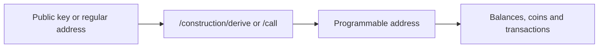

# CIP-113 Programmable Tokens

## Overview

CIP-113 programmable tokens are native Cardano assets governed by on-chain validation logic. This allows issuers to enforce rules such as transfer restrictions, freezing or seizure while keeping the token compatible with Cardano’s native-asset model. A programmable token is identified by its policy ID and asset name, just like any other native asset.

For a Rosetta integrator, the important difference is where the token is held: programmable tokens are sent to a programmable address rather than the customer’s regular address. The programmable address is a separate account, so query it independently from the customer’s regular address.

A programmable address is a base address with two parts:

- **Payment credential**: the hash of the `programmable_logic_base` (**PLB**) script. Addresses generated by this Rosetta instance share the hash configured in [`CIP113_BASE_SCRIPT_HASH`](../../install-and-deploy/env-vars.md).
- **Stake credential**: the owner’s key hash, selected from the input as explained in [Deriving and Resolving Addresses](./addresses.md#the-owner-credential-rosetta-uses).

## Phase 1 support

Cardano Rosetta Java’s Phase 1 CIP-113 implementation focuses on programmable-address handling and querying existing on-chain activity. This phase lets you:

1. Derive a programmable address from a public key with [`/construction/derive`](./addresses.md#deriving-an-address-constructionderive).
2. Resolve a supported customer address with [`/call`](./addresses.md#resolving-an-address-call).
3. Read balances, UTxOs and transaction history with the standard [Data API](./querying.md).

Transaction building and signing are not included in this phase and may be added in a future phase. Use transaction-building tooling from the [CIP-113 platform](https://github.com/cardano-foundation/cip113-programmable-tokens-platform), then use Rosetta to query the resulting on-chain activity.

:::tip The short version
Query the customer’s programmable address for programmable tokens. Query the customer’s regular address separately for ADA and other native assets. They are different accounts and Rosetta does not link them automatically.
:::

## References

- [CIP-113 specification](https://cips.cardano.org/cip/CIP-0113)
- [CIP-113 on-chain contracts](https://github.com/cardano-foundation/cip113-programmable-tokens)
- [CIP-113 platform](https://github.com/cardano-foundation/cip113-programmable-tokens-platform)
- [Native Tokens guide](../multi-assets.md)
- [Token Metadata guide](../../advanced-configuration/token-metadata.md)
