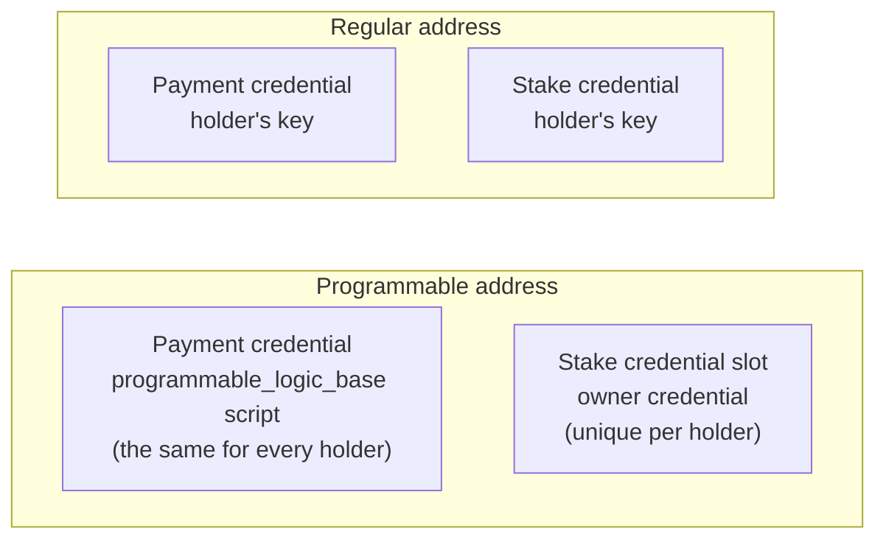
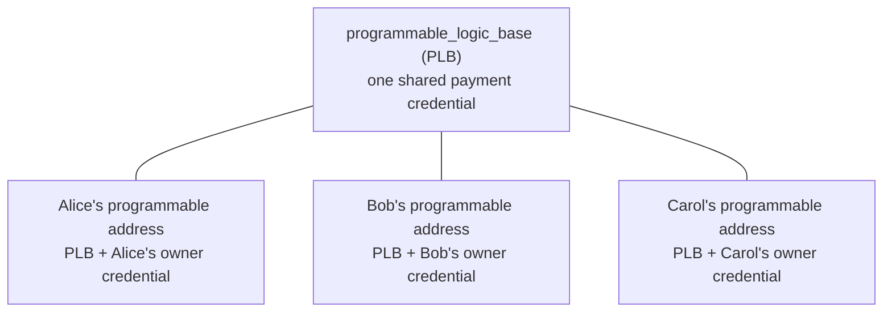
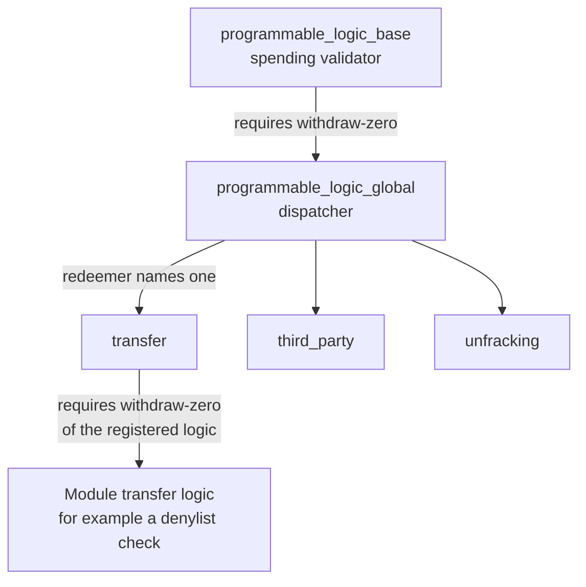

# CIP-113 Programmable Tokens

## Overview

**Programmable tokens** are native Cardano assets with an additional layer of validation logic that runs on every transfer. They are the building block for regulated assets such as stablecoins and tokenized securities, where an issuer must be able to enforce rules (for example sanctions screening, or freezing and seizing a holding) at the protocol level.

They are defined by [CIP-113](https://cips.cardano.org/cip/CIP-0113) and implemented by the Cardano Foundation in two repositories:

- [`cip113-programmable-tokens`](https://github.com/cardano-foundation/cip113-programmable-tokens): the on-chain smart contracts (Aiken)
- [`cip113-programmable-tokens-platform`](https://github.com/cardano-foundation/cip113-programmable-tokens-platform): the off-chain platform, reference frontend and example modules

Cardano Rosetta Java supports programmable tokens from version **2.4.0**. Rosetta is mainly concerned with the **holder's address**, so the guides in this section focus on how an exchange or custodian can:

1. [Derive](./addresses.md) the programmable address of a customer from the public key it already uses today.
2. [Resolve](./addresses.md#resolving-an-address-call) any customer address (deposit or withdrawal destination) to that programmable address.
3. [Query](./querying.md) balances, coins and transactions of that address with the standard Data API endpoints.

:::tip In short
A programmable token is still an ordinary native asset. It is identified by `policyId` and asset name like any other, and the Data API reports it in the usual `tokenBundle` metadata. What changes is **where it lives**: not at the customer's regular address, but at a *programmable address* that Rosetta can derive for you.
:::

## How programmable tokens are held

A regular Cardano address has a payment credential that belongs to the holder (and, for a base address, a stake credential that does too). A programmable token is instead held at a **shared custody address**:

- The **payment credential** is the hash of the `programmable_logic_base` script (**PLB**). It is shared by all holders of all programmable tokens in one deployment.
- The **stake credential slot** carries the **owner credential**. It is what makes the address unique to one holder and decides who is allowed to spend from it.

Transferring programmable tokens therefore means moving them from one programmable address to another, changing only the owner credential.

:::info Why this matters for the Data API
All programmable tokens of all holders sit under the same payment credential. Querying by payment credential alone would return everyone's tokens. Rosetta queries by the **full address**, so you always need the holder's complete programmable address.
:::

### The owner credential

The stake credential slot can hold three kinds of credential. The on-chain validators do not care which one is used, only whether it is a key (needs a signature) or a script (needs a withdraw-zero invocation):

| Owner credential          | Authorizes a spend with        | Typical use                                              |
| ------------------------- | ------------------------------ | -------------------------------------------------------- |
| Stake key hash            | Signature of the stake key     | Standard wallets with a base address                     |
| Payment key hash          | Signature of the payment key   | Enterprise wallets without a stake key, such as exchanges |
| Script hash               | Script invocation (withdraw-zero) | dApps and smart contracts holding programmable tokens |

Which credential goes into the slot is an off-chain convention, not an on-chain rule. [Deriving and Resolving Addresses](./addresses.md#the-owner-credential-rosetta-uses) explains the convention Rosetta follows.

## What happens when programmable tokens move

You do not need to build these transactions to use Rosetta's Data API, but the chain of validators explains what you will see on chain.

1. Spending a programmable UTxO always runs **PLB**. PLB does one thing: it requires the dispatcher to run.
2. The dispatcher, **`programmable_logic_global`**, requires one *delegate* validator, chosen by its redeemer:
   - **`transfer`**: an ordinary, owner-authorized transfer.
   - **`third_party`**: an issuer action such as a seizure, clawback or freeze enforcement. The holder's consent is not required.
   - **`unfracking`**: a holder-driven restructuring of the holder's own UTxOs.
3. For a transfer, the delegate checks that the owner consented and that the token is registered, then requires the token's own **module** logic to run.

PLB is a *spending* validator: it runs when a programmable UTxO is spent. The dispatcher, the delegates and the module logic are *stake* validators triggered with **withdraw-zero**: a withdrawal of 0 ADA from a script's stake address. It runs the script without moving any funds, once per transaction instead of once per UTxO.

:::note Withdraw-zero operations are filtered
Zero-value withdrawals are script invocations, not balance changes. Cardano Rosetta Java does not return them as `withdrawal` operations in `/block`, `/block/transaction` and `/search/transactions`, so the operations you receive describe the actual movement of ADA and tokens.
:::

### Registry and modules

- The **registry** (also called the directory) is an on-chain sorted linked list with one entry per registered programmable token policy. An entry points to the logic scripts that govern the token.
- A **module** is the pluggable rule set a token obeys. The platform repository ships a `dummy` (permissioned transfer), a `freeze-and-seize` (denylist, freeze and seize), a `kyc` and a `kyc-extended` module.

## What Rosetta supports

| Capability                                                                 | Supported |
| -------------------------------------------------------------------------- | :-------: |
| Derive a programmable address from a public key (`/construction/derive`)   |    Yes    |
| Resolve an enterprise, base or key-owned programmable address (`/call`)    |    Yes    |
| Balance and UTxOs of a programmable address (`/account/balance`, `/account/coins`) | Yes |
| Transactions of a programmable address (`/search/transactions`, `/block`, `/block/transaction`) | Yes |
| Token names, tickers and decimals through the token registry               |    Yes    |
| Build, sign or submit programmable-token transfers (`/construction/*`)     |    No     |
| Tell whether a policy is programmable, or read denylist and freeze state   |    No     |

:::important Not covered yet
Rosetta does not build programmable-token transfers today: the Construction API cannot create transactions that spend programmable tokens, because those transactions need the programmable-token validators, registry proofs and withdraw-zero invocations described above. Use the [reference platform](https://github.com/cardano-foundation/cip113-programmable-tokens-platform) or your own tooling to build and submit them. Rosetta then reports the result through the Data API.
:::

## Configuration

Address derivation and resolution need the PLB script hash of the deployment you connect to. Set it with `CIP113_BASE_SCRIPT_HASH` (see [Environment Variables](../../install-and-deploy/env-vars.md)). The shipped Docker Compose and Helm profiles already set it for mainnet and preprod:

| Network | `CIP113_BASE_SCRIPT_HASH`                                    |
| ------- | ------------------------------------------------------------ |
| mainnet | `d91d08e381f8ef95ffbb3f8048f020d7361ded8f3abfdf66c25fa838` |
| preprod | `be59f7750a5d947bb649e70d574d066791ec34a1dfee2a087c8511e3` |

If the variable is empty, the data endpoints keep working, but derive with `CIP-113` and `resolve_smart_wallet_addr` fail with error `5063`.

## Next steps

- [Deriving and Resolving Addresses](./addresses.md): get the programmable address of a customer.
- [Querying a Programmable Address](./querying.md): read the tokens held at that address.
- [Native Tokens](../multi-assets.md): how tokens are represented in Rosetta operations.
- [Enabling Token Metadata](../../advanced-configuration/token-metadata.md): show token names, tickers and decimals.
