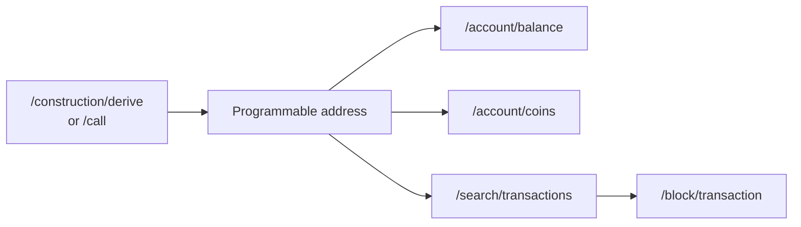

# Querying Balances, Coins and Transactions

## Overview

Programmable tokens need **no new Data API endpoints**. Once you have the customer's [programmable address](./addresses.md), you query it exactly like any other address. This is possible because the indexer stores every address as it appears on chain, and the programmable address is a regular Cardano address.



| Question                                       | Endpoint                                  | Address to send                    |
| ---------------------------------------------- | ----------------------------------------- | ---------------------------------- |
| How many tokens does the customer hold?        | `/account/balance`                        | Programmable address               |
| Which UTxOs hold them (needed as coin inputs)? | `/account/coins`                         | Programmable address               |
| Which transactions moved them?                 | `/search/transactions`                    | Programmable address               |
| What does one transaction contain?             | `/block/transaction`, `/search/transactions` | Transaction hash                |

:::important Two independent addresses per customer
The enterprise address holds ADA and regular native tokens. The programmable address holds programmable tokens (and the minimum ADA that travels with them). Query both. They are separate accounts and there is no linking between them.
:::

## Balance

Send the programmable address as `account_identifier.address`:

```json
{
  "network_identifier": {
    "blockchain": "cardano",
    "network": "preprod"
  },
  "account_identifier": {
    "address": "addr_test1zzl9nam4pfweg7akf8ns646dqenermp55807u2sg0jz3rc6as3x55d8yw38nxlpxn3ysgqzlyj334dcj3h9lv5nhakcsudhvdm"
  }
}
```

The response has the same structure as for any address (see the [balance example](../multi-assets.md#account-balance-and-utxo-queries)): the `block_identifier` of the latest indexed block and a `balances` list.

- The list contains **everything** held at the address: ADA plus every asset, programmable or not. Rosetta does not filter by asset type.
- Each token is a separate entry. Its `currency.metadata.policyId` is the policy ID and `currency.symbol` is the asset name, hex-encoded (see [Token names](#token-names-tickers-and-decimals)).
- Add `block_identifier` (`index` or `hash`) to get the balance as of a past block.
- Use the `currencies` filter to restrict the response to some tokens. The filter matches on `symbol` only; it does not look at the policy ID, so two policies that use the same asset name are not distinguished by it.

## Coins (UTxOs)

`/account/coins` returns the unspent outputs at the programmable address. Use the same request as for the balance. Each entry has a `coin_identifier` (`<transaction hash>:<output index>`), the ADA `amount` of the output, and the tokens of that output in `metadata`, keyed by the coin identifier. The `coin_identifier` is the value an input operation references in its `coin_change`. The structure is identical to the one used for regular native tokens (see the [UTxO example](../multi-assets.md#account-balance-and-utxo-queries)).

## Transactions

Search by address to get the history of the programmable address, or by transaction hash to inspect one transaction.

```json
{
  "network_identifier": {
    "blockchain": "cardano",
    "network": "preprod"
  },
  "account_identifier": {
    "address": "addr_test1zzl9nam4pfweg7akf8ns646dqenermp55807u2sg0jz3rc6as3x55d8yw38nxlpxn3ysgqzlyj334dcj3h9lv5nhakcsudhvdm"
  },
  "limit": 10
}
```

The response is the usual `transactions` list with `total_count` and `next_offset` for paging. Programmable-token transactions use the same operation model as any other transaction:

- `input` operations carry **negative** amounts and `coin_spent`, `output` operations carry **positive** amounts and `coin_created`.
- Tokens are in `metadata.tokenBundle` of the operation, with the same sign as the ADA amount.
- The `account.address` of an operation is the **programmable address** when the UTxO sits at one, and the holder's regular address for everything else, such as the UTxO that pays the fee.
- The fee is implicit: it is the difference between all inputs and all outputs in ADA.

### Example: splitting and burning tokens

These two real preprod transactions are chained. They involve 10 tokens of policy `ba748823...` (hex asset name `524550`, which decodes to `REP`) held at the programmable address `addr_test1zzl9nam...dvdm`.

1. Transaction [`54938c56...`](https://preprod.cardanoscan.io/transaction/54938c566d8f4c045afb5e2892a5416f2f06c913ba2a444b1ea43c9b45232361) (block `5259307`) splits one output of 10 tokens into two outputs of 6 and 4 at the same programmable address.
2. Transaction [`83dbb697...`](https://preprod.cardanoscan.io/transaction/83dbb697e580ef9406b640edbe56cf926853c1bf41a027d963e3ca163cc72b30) (block `5259310`) spends the output of 6 and sends 3 back to the same programmable address. The other 3 are **burned**.

The second transaction looks like this through `/block/transaction` (the same data is returned by `/search/transactions`):

```json
{
  "transaction": {
    "transaction_identifier": {
      "hash": "83dbb697e580ef9406b640edbe56cf926853c1bf41a027d963e3ca163cc72b30"
    },
    "operations": [
      {
        "operation_identifier": { "index": 0 },
        "type": "input",
        "status": "success",
        "account": {
          "address": "addr_test1zzl9nam4pfweg7akf8ns646dqenermp55807u2sg0jz3rc6as3x55d8yw38nxlpxn3ysgqzlyj334dcj3h9lv5nhakcsudhvdm"
        },
        "amount": {
          "value": "-1300000",
          "currency": { "symbol": "ADA", "decimals": 6 }
        },
        "coin_change": {
          "coin_identifier": {
            "identifier": "54938c566d8f4c045afb5e2892a5416f2f06c913ba2a444b1ea43c9b45232361:0"
          },
          "coin_action": "coin_spent"
        },
        "metadata": {
          "tokenBundle": [
            {
              "policyId": "ba74882344a7946a04139263c4896703a7107f522bbf061c311aac6c",
              "tokens": [
                {
                  "value": "-6",
                  "currency": {
                    "symbol": "524550",
                    "decimals": 0,
                    "metadata": {
                      "policyId": "ba74882344a7946a04139263c4896703a7107f522bbf061c311aac6c"
                    }
                  }
                }
              ]
            }
          ]
        }
      },
      {
        "operation_identifier": { "index": 1 },
        "type": "input",
        "status": "success",
        "account": {
          "address": "addr_test1vqm5vyp8xztmxyl6mcr2xr5schajvsq8fjs8gn8g2zu0pgg8gckcp"
        },
        "amount": {
          "value": "-9963485766",
          "currency": { "symbol": "ADA", "decimals": 6 }
        },
        "coin_change": {
          "coin_identifier": {
            "identifier": "54938c566d8f4c045afb5e2892a5416f2f06c913ba2a444b1ea43c9b45232361:2"
          },
          "coin_action": "coin_spent"
        }
      },
      {
        "operation_identifier": { "index": 2, "network_index": 0 },
        "related_operations": [{ "index": 0 }, { "index": 1 }],
        "type": "output",
        "status": "success",
        "account": {
          "address": "addr_test1zzl9nam4pfweg7akf8ns646dqenermp55807u2sg0jz3rc6as3x55d8yw38nxlpxn3ysgqzlyj334dcj3h9lv5nhakcsudhvdm"
        },
        "amount": {
          "value": "1300000",
          "currency": { "symbol": "ADA", "decimals": 6 }
        },
        "coin_change": {
          "coin_identifier": {
            "identifier": "83dbb697e580ef9406b640edbe56cf926853c1bf41a027d963e3ca163cc72b30:0"
          },
          "coin_action": "coin_created"
        },
        "metadata": {
          "tokenBundle": [
            {
              "policyId": "ba74882344a7946a04139263c4896703a7107f522bbf061c311aac6c",
              "tokens": [
                {
                  "value": "3",
                  "currency": {
                    "symbol": "524550",
                    "decimals": 0,
                    "metadata": {
                      "policyId": "ba74882344a7946a04139263c4896703a7107f522bbf061c311aac6c"
                    }
                  }
                }
              ]
            }
          ]
        }
      },
      {
        "operation_identifier": { "index": 3, "network_index": 1 },
        "related_operations": [{ "index": 0 }, { "index": 1 }],
        "type": "output",
        "status": "success",
        "account": {
          "address": "addr_test1vqm5vyp8xztmxyl6mcr2xr5schajvsq8fjs8gn8g2zu0pgg8gckcp"
        },
        "amount": {
          "value": "9963030132",
          "currency": { "symbol": "ADA", "decimals": 6 }
        },
        "coin_change": {
          "coin_identifier": {
            "identifier": "83dbb697e580ef9406b640edbe56cf926853c1bf41a027d963e3ca163cc72b30:1"
          },
          "coin_action": "coin_created"
        }
      }
    ],
    "metadata": { "size": 685, "scriptSize": 3892 }
  }
}
```

How to read it:

| Operation | What it is                                                                                              |
| --------- | ------------------------------------------------------------------------------------------------------- |
| 0         | Spends the output of 6 tokens (and its 1.3 ADA) from the programmable address.                           |
| 1         | Spends an ADA-only output of a regular enterprise address, which pays the transaction fee.               |
| 2         | Creates the output of 3 tokens (and 1.3 ADA) back at the programmable address.                           |
| 3         | Returns the ADA change to the enterprise address.                                                        |

The token bundle is **not balanced**: 6 tokens go in and 3 come out. Rosetta has no operation type for minting or burning, so the difference is the burned (or minted) amount. See [Minting and Burning Observations](../multi-assets.md#operations-with-native-tokens). The withdraw-zero script invocations that this transaction contains do not appear as operations (see [filtering](./index.md#what-happens-when-programmable-tokens-move)).

:::note Third-party actions
A seizure, clawback or freeze enforcement by the issuer is a *third-party action*, not a voluntary transfer, and it needs no signature of the holder. In the Data API it is still reported as ordinary `input` and `output` operations. If you need to tell the two apart, decode the transaction on your side and look at the redeemer of the `programmable_logic_global` withdrawal: `ThirdPartyAct` marks a third-party action.
:::

## Token names, tickers and decimals

A programmable token is identified exactly like every native asset: by **policy ID and asset name**. The CIP-113 repositories do not define a separate naming scheme.

| Field in the response                 | Meaning                                                               |
| ------------------------------------- | --------------------------------------------------------------------- |
| `currency.symbol`                     | Asset name, hex-encoded (`524550` is `REP`)                           |
| `currency.metadata.policyId`          | Policy ID of the token                                                |
| `currency.decimals`                   | `0` unless the token registry provides a value                        |

To show a readable name, ticker, description or the real number of decimals, enable the token registry integration described in [Enabling Token Metadata](../../advanced-configuration/token-metadata.md). Rosetta then adds `subject`, `name`, `description`, `ticker`, `url` and `decimals` to `currency.metadata`, for programmable tokens as for any other native asset. The guide shows a before and after example. Tokens that are not in the registry keep only the `policyId`, which is not an error.

Companion assets of a programmable policy, such as a CIP-68 reference NFT, are the responsibility of the token's module, not of the CIP-113 base layer. Check with the issuer how a given token publishes its metadata.

## Is a token programmable?

Rosetta reports a programmable token like any other native asset, and does not mark it as programmable. To find out, look up the policy ID in the on-chain **registry**: if a registry entry with that policy ID as key exists, the token is programmable, and the entry names the module that governs it. Registry entries can be updated in place by the token's issuer, so resolve the current entry at the time you need it instead of caching it.

Rosetta does not expose the registry, so this lookup is done with the CIP-113 tooling or an indexer that reads the registry. Most exchanges only need it when they list a new policy.

## Pitfalls

| Pitfall                                                        | Explanation and fix                                                                                                                                      |
| -------------------------------------------------------------- | -------------------------------------------------------------------------------------------------------------------------------------------------------- |
| Querying the enterprise address for programmable tokens        | They are not there. Query the programmable address.                                                                                                      |
| Wrong credential convention gives a zero balance               | If the sender used a stake key hash as owner and you derived the address from the payment key (or the reverse), the address differs. See [the warning](./addresses.md#the-owner-credential-rosetta-uses). |
| Expecting a mint or burn operation                             | There is none. A token bundle that does not balance between inputs and outputs means tokens were minted or burned.                                       |
| Expecting zero-value withdrawals in the operations             | They are filtered. The remaining operations describe only the movement of ADA and tokens.                                                                |
| Treating a script owner as a person                            | A programmable address can be owned by a script (a dApp or a DAO). Its stake credential slot is a script hash. Do not assume that every owner is a wallet. |
| Using the `currencies` filter to separate policies             | The filter matches on the symbol only. Check `currency.metadata.policyId` in the result.                                                                 |

## Next steps

- [Deriving and Resolving Addresses](./addresses.md): get the programmable address of a customer.
- [Native Tokens](../multi-assets.md): token operations and the sign convention.
- [API Reference](/cardano-rosetta-java/api): schemas of all Data API endpoints.
